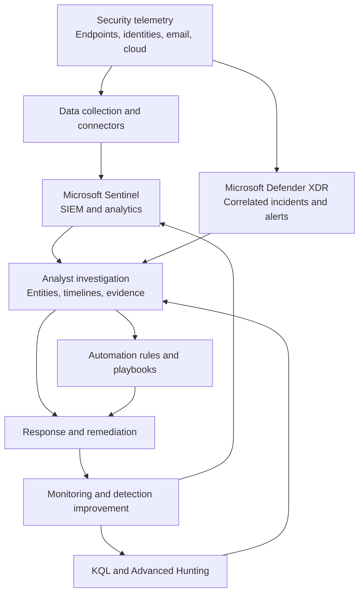
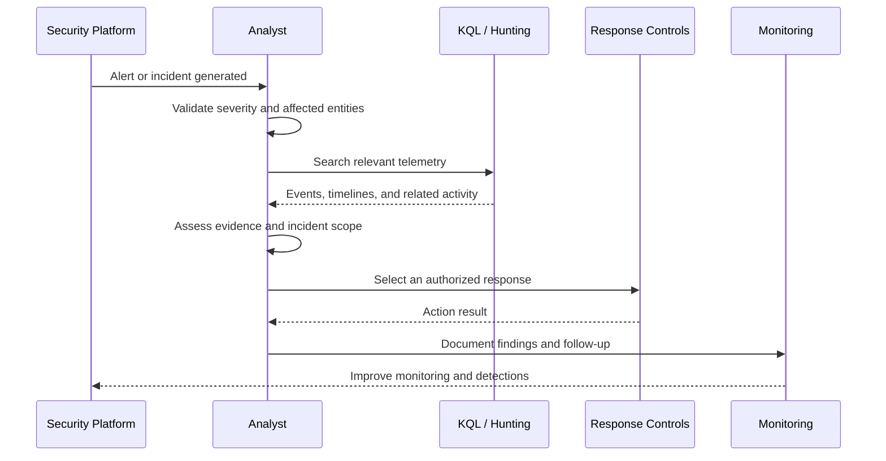
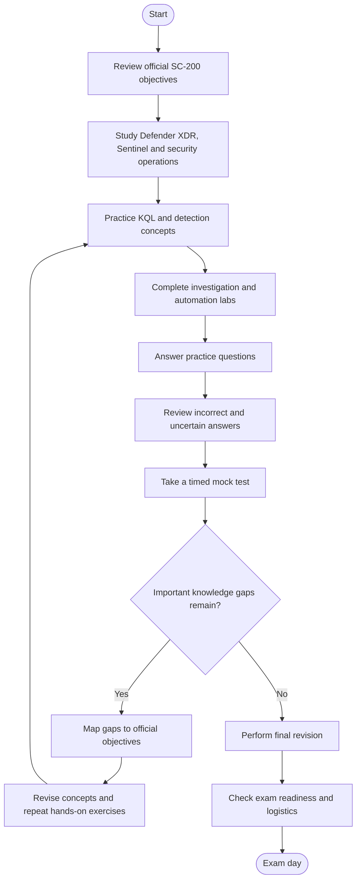
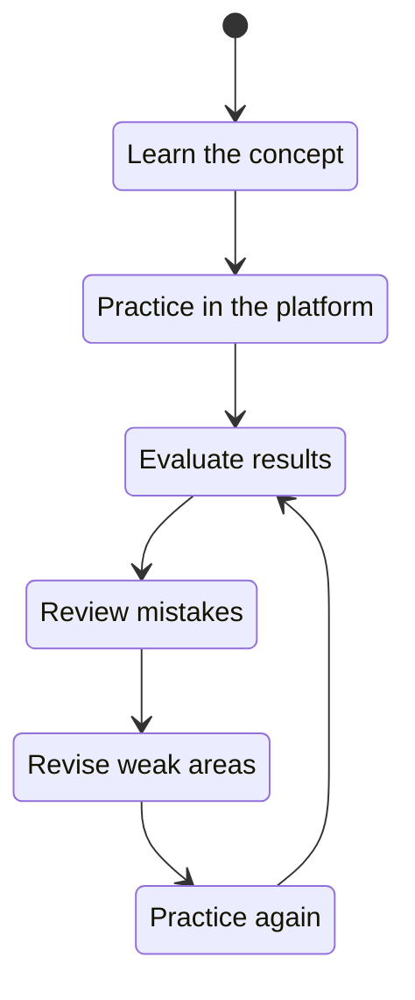
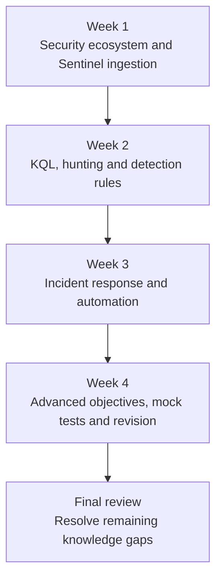

# Microsoft SC-200: Security Operations Analyst Associate — Study Guide

A practical study guide for preparing for the **Microsoft SC-200 exam**, associated with the **Microsoft Certified: Security Operations Analyst Associate** certification.

This repository covers security operations, Microsoft Defender XDR, Microsoft Sentinel, incident investigation, Kusto Query Language (KQL), threat hunting, detection engineering, and security automation. It combines official exam objectives with independent study recommendations, example queries, practical projects, and a structured revision plan.

**Official exam information:** [Microsoft SC-200 exam and certification](https://learn.microsoft.com/en-us/credentials/certifications/exams/sc-200)

**Additional preparation:** [CertsGate](https://certsgate.com/) 
---

## Table of Contents

- [Overview](#overview)
- [About the SC-200 Certification](#about-the-sc-200-certification)
- [Who Should Prepare?](#who-should-prepare)
- [Exam Details](#exam-details)
- [Official Exam Objectives](#official-exam-objectives)
- [Exam Domain Weightage](#exam-domain-weightage)
- [Security Operations Architecture](#security-operations-architecture)
- [Incident Investigation Workflow](#incident-investigation-workflow)
- [Certification Preparation Flowchart](#certification-preparation-flowchart)
- [Circular Study and Revision Cycle](#circular-study-and-revision-cycle)
- [Step-by-Step Preparation Guide](#step-by-step-preparation-guide)
- [KQL Practice Examples](#kql-practice-examples)
- [Recommended Study Roadmap](#recommended-study-roadmap)
- [Practice Questions](#practice-questions)
- [Hands-On Projects](#hands-on-projects)
- [Common Preparation Mistakes](#common-preparation-mistakes)
- [Career Relevance](#career-relevance)
- [Frequently Asked Questions](#frequently-asked-questions)
- [Official and Additional Learning Resources](#official-and-additional-learning-resources)
- [About CertsGate](#about-certsgate)

---

## Overview

Security operations analysts help organizations identify suspicious activity, investigate security alerts, respond to incidents, and improve detection coverage. The SC-200 exam focuses on these responsibilities within Microsoft's security ecosystem.

Preparation involves more than memorizing product names. You should understand how alerts become incidents, how to investigate affected identities and devices, how to query telemetry with KQL, and how to configure detections and automation appropriately.

This **SC-200 study guide** organizes learning around Microsoft's published skill areas. It also includes example KQL queries, security workflow diagrams, practice questions, and lab ideas to help connect exam concepts with practical security operations.

### What you will learn

- Microsoft Defender XDR and Microsoft Sentinel
- Alert triage and incident investigation
- Microsoft Defender for Endpoint and device investigation
- Microsoft Entra ID identity-related investigations
- Microsoft Defender for Office 365 and Defender for Cloud
- Microsoft Purview investigations and audit capabilities
- KQL and Advanced Hunting
- Sentinel analytics rules, workbooks, and data connectors
- Automation rules, playbooks, and automated investigation
- Threat intelligence, MITRE ATT&CK, and threat hunting
- Security Copilot and relevant AI-assisted investigation capabilities

## About the SC-200 Certification

Microsoft Certified: Security Operations Analyst Associate is an intermediate-level certification for professionals who monitor, investigate, and respond to threats in organizational environments.

The role includes triaging alerts, investigating incidents across security products, creating detections, hunting for threats, and helping reduce organizational risk. Microsoft's current study guide also includes objectives involving AI agents, Copilots, and the Sentinel MCP Server.

Official reference: [Microsoft Security Operations Analyst Associate](https://learn.microsoft.com/en-us/credentials/certifications/security-operations-analyst/)

## Who Should Prepare?

The SC-200 exam may be relevant to:

- Security operations center (SOC) analysts
- Incident responders and threat hunters
- Security engineers working with Microsoft security products
- Microsoft Sentinel administrators
- Analysts who investigate endpoint and identity threats
- IT professionals moving into security monitoring and detection engineering
- Security professionals who want structured practice with KQL

Microsoft recommends familiarity with security, compliance, and identity solutions, Microsoft 365, Azure cloud services, AI agents and Copilots, and Windows, Linux, and mobile operating systems.

If you are new to security operations, first learn the basics of authentication, endpoints, network activity, security alerts, and log analysis. Then progress to investigations and automation.

## Exam Details

| Item | Information |
|---|---|
| Exam code | SC-200 |
| Certification | Microsoft Certified: Security Operations Analyst Associate |
| Provider | Microsoft |
| Level | Intermediate |
| Role | Security Operations Analyst |
| Main products | Microsoft Defender XDR, Microsoft Sentinel, and related Microsoft security services |
| Passing score | 700 or greater, according to Microsoft's study guide |
| Exam duration | 100 minutes, according to the official certification page |
| Question count | Check current official exam information; do not assume a fixed count |
| Skills measured | October 21, 2026 version of the official study guide |
| Renewal | Microsoft lists a 12-month renewal cycle for this associate certification |

Exam policies, languages, availability, pricing, and delivery details may change. Confirm the current information on Microsoft's official pages before scheduling.

Official links:

- [SC-200 exam page](https://learn.microsoft.com/en-us/credentials/certifications/exams/sc-200)
- [Official SC-200 study guide](https://learn.microsoft.com/en-us/credentials/certifications/resources/study-guides/sc-200)
- [Certification renewal information](https://learn.microsoft.com/en-us/credentials/certifications/renew-your-microsoft-certification)

## Official Exam Objectives

Microsoft's study guide identifies three main skill areas. The published percentages are ranges, not fixed percentages for every individual exam form.

### 1. Manage a Security Operations Environment — 40–45%

This domain covers configuring, operating, and improving a security operations environment.

#### Microsoft Defender XDR and Sentinel automation

Study how to:

- Configure email and alert notifications.
- Tune alerts, configure suppression, and understand alert correlation.
- Configure Microsoft Defender for Endpoint advanced features and attack surface reduction rules.
- Manage automated investigation and response.
- Understand automatic attack disruption.
- Configure device groups, permissions, and automation levels.
- Create Microsoft Sentinel automation rules.
- Configure Sentinel playbooks.

#### Microsoft Sentinel platform

Understand how to:

- Assign and manage Sentinel roles.
- Configure data retention across relevant data tiers.
- Create and configure workbooks.
- Review SOC optimization recommendations.
- Understand platform configuration and operational requirements.

#### Data ingestion

Practice selecting and configuring appropriate connectors and collection methods, including:

- Windows Security Events via Azure Monitor Agent (AMA)
- Windows Event Forwarding (WEF)
- Syslog and Common Event Format (CEF) via AMA
- Azure activity logs and resource diagnostic settings
- Threat indicator ingestion
- Custom log tables

#### Detection engineering

Learn to:

- Create and manage custom detections in Microsoft Defender XDR.
- Configure scheduled, near-real-time, threat-intelligence, and machine-learning analytics rules in Microsoft Sentinel.
- Review detection coverage using MITRE ATT&CK.
- Configure and investigate anomalies.

**Practical goal:** Build an understanding of how telemetry enters the security platform, how detections identify suspicious behavior, and how automation can support a controlled response.

### 2. Respond to Security Incidents — 35–40%

This domain focuses on investigation, containment, remediation, and understanding the wider scope of an incident.

#### Microsoft Defender XDR investigations

Study how to investigate and remediate threats involving:

- Microsoft Defender for Office 365
- Microsoft Purview
- Microsoft Defender for Cloud workload protections
- Microsoft Defender for Cloud Apps
- Microsoft Entra ID
- Microsoft Defender for Identity
- Microsoft Sentinel
- Microsoft Security Copilot and embedded AI-assisted investigation capabilities

Learn to investigate complex, multi-stage attacks and lateral movement. Understand incident case management and how evidence from multiple sources contributes to a single investigation.

#### Microsoft Defender for Endpoint

Practice understanding:

- Device timelines
- Evidence and entity investigation
- Live response
- Investigation packages
- Alerts and incidents associated with automatic attack disruption

#### Microsoft 365 activity investigations

Understand how Microsoft Purview Audit, Content Search in Microsoft Purview eDiscovery, and Microsoft Graph activity logs can support investigations.

**Practical goal:** Given a suspicious alert, determine what happened, which identities or devices may be affected, what evidence supports the finding, and which response actions are appropriate.

### 3. Perform Threat Hunting — 20–25%

Threat hunting involves actively searching for suspicious behavior instead of waiting for existing alerts.

#### Microsoft Defender XDR

Learn to:

- Identify the appropriate tables for KQL queries.
- Write and interpret Advanced Hunting queries.
- Analyze threat analytics.
- Create hunting graphs and understand blast radius.
- Investigate relationships between entities using Sentinel Graph.

#### Microsoft Sentinel

Study how to:

- Create and monitor hunting queries.
- Use KQL to investigate relevant log data.
- Create and manage KQL jobs in the data lake.
- Work with summary rule tables.
- Use notebooks for threat hunting.
- Understand the Sentinel MCP Server in the context of the published objectives.

**Practical goal:** Develop a hypothesis about suspicious behavior, identify the relevant telemetry, write a query, inspect the results, and document whether the evidence supports the hypothesis.

For the complete objective list, use the [official SC-200 study guide](https://learn.microsoft.com/en-us/credentials/certifications/resources/study-guides/sc-200).

## Exam Domain Weightage

The following values are the ranges published in Microsoft's study guide dated October 21, 2026.

| Official skill area | Published weight |
|---|---:|
| Manage a security operations environment | 40–45% |
| Respond to security incidents | 35–40% |
| Perform threat hunting | 20–25% |

### Visual comparison of published ranges

```mermaid
xychart-beta
    title "SC-200 Official Skill Weight Ranges"
    x-axis ["Manage environment", "Respond to incidents", "Threat hunting"]
    y-axis "Percentage" 0 --> 50
    bar [40, 35, 20]
    bar [45, 40, 25]
```



The first series represents each domain's lower bound; the second represents its upper bound. These are endpoints of published ranges, not separate components of one fixed exam distribution.

A pie chart would require choosing one value from each range and would imply a single distribution that Microsoft has not specified in these ranges. This guide therefore uses the official ranges directly rather than presenting invented pie-chart values as official facts.

**Study recommendation:** Give substantial attention to security environment management and incident response while maintaining regular practice with KQL and threat hunting. Do not skip a domain simply because it has a smaller published range.

## Security Operations Architecture

The following conceptual diagram shows how telemetry, detection, investigation, and response can fit together in a Microsoft security operations environment. It is an illustrative workflow, not a requirement to deploy every service in every organization.



### What the components do

| Component | Role in security operations |
|---|---|
| Telemetry sources | Generate activity records, alerts, and security-relevant events |
| Data connectors | Bring supported data into the relevant security platform |
| Microsoft Sentinel | Supports SIEM analytics, hunting, workbooks, and automation |
| Microsoft Defender XDR | Correlates security signals and supports cross-product incident investigation |
| KQL and Advanced Hunting | Help analysts search telemetry for suspicious behavior |
| Analyst investigation | Connects alerts, entities, evidence, and timeline events |
| Automation rules and playbooks | Apply configured workflows and actions to appropriate events |
| Monitoring and improvement | Helps identify gaps in detections, data collection, and response processes |

Actual data availability depends on licensing, configuration, connectors, permissions, and the products deployed.

## Incident Investigation Workflow

A useful analyst workflow starts with the alert and builds an evidence-based understanding of what happened.



The diagram represents a conceptual investigation pattern. Real investigations may require repeated queries, additional evidence, escalation, or approval before containment and remediation.

## Certification Preparation Flowchart

Use this workflow to move from reading the objectives to assessing readiness. If practice reveals a gap, return to the relevant material and test the concept again.



## Circular Study and Revision Cycle

Security operations knowledge develops through repetition. You should be able to explain why a query works, what the results mean, and what additional evidence would be needed before taking action.



For example, if a KQL query returns no results, check the table name, available columns, time range, and assumptions in the query. Then test a simpler query before adding more filters.

## Step-by-Step Preparation Guide

### Step 1: Establish your baseline

Read the current study guide and mark each objective as not started, in progress, or ready for review.

Identify any gaps in:

- Security alert and incident concepts
- Microsoft security product capabilities
- KQL syntax and query logic
- Sentinel data collection
- Detection rules and automation
- Investigation and response procedures

Use the checklist to organize your study rather than relying on an unstructured list of videos or practice tests.

### Step 2: Learn the Microsoft security ecosystem

Understand the responsibilities of Microsoft Sentinel, Microsoft Defender XDR, Defender for Endpoint, Defender for Office 365, Defender for Cloud, Microsoft Entra ID, and Microsoft Purview.

Focus on when each service is relevant and what evidence it can provide. Avoid assuming that every alert, log, and response action is available in every tenant.

### Step 3: Build KQL fundamentals

KQL is central to threat hunting and investigation. Practice filtering, selecting columns, sorting, summarizing, grouping, joining, and working with timestamps.

Learn how to identify the appropriate table before writing a complicated query. Understand the difference between a query that produces a result and one that provides meaningful evidence for an investigation.

### Step 4: Practice incident investigation

Use a documented scenario to work through the investigation process:

1. Read the alert and its severity.
2. Identify affected identities, devices, applications, or other entities.
3. Review relevant timeline events.
4. Search for related activity using KQL.
5. Assess the scope and supporting evidence.
6. Select an appropriate response within the permissions of your lab.
7. Document the result and any remaining uncertainty.

Practice both endpoint-focused investigations and incidents involving identities, email, cloud applications, or multiple security products.

### Step 5: Learn Sentinel data collection and detection

Understand how data connectors, agents, data collection rules, and diagnostic settings affect what appears in the workspace.

Practice the difference between a hunting query and an analytics rule. Learn how scheduled, near-real-time, threat-intelligence, and other rule types fit different detection needs.

Review how workbooks, retention, and SOC optimization support daily operations.

### Step 6: Study automation carefully

Learn how Sentinel automation rules and playbooks can help standardize response workflows. Understand the difference between identifying a threat and authorizing an action that changes a system.

In practice environments, test the conditions that trigger an automation, the actions it performs, and the safeguards that prevent unintended impact.

### Step 7: Practice threat hunting and incident response together

Use a small scenario such as unusual process activity, repeated failed logons, or suspicious outbound connections.

Form a hypothesis, identify relevant data, write a KQL query, inspect the results, and explain what you can and cannot conclude. Then consider which additional evidence or detection would help.

### Step 8: Review gaps and measure readiness

Use Microsoft's official practice assessment and the relevant study guide. For every incorrect or uncertain answer, record:

- The objective being tested
- Why the chosen answer was wrong
- The correct reasoning
- The relevant product or KQL concept
- A practical exercise that would reinforce the concept

Do not treat a single mock-test score as proof that every skill is ready.

## KQL Practice Examples

The following examples illustrate query patterns. Table availability, schema, permissions, and time ranges vary by product and environment. Use the table schema available in your own Microsoft Defender XDR or Sentinel environment.

### Example 1: Inspect recent process activity

In Microsoft Defender XDR Advanced Hunting, `DeviceProcessEvents` can be used to investigate process creation activity.

```kusto
DeviceProcessEvents
| where Timestamp > ago(24h)
| project
    Timestamp,
    DeviceName,
    AccountName,
    FileName,
    ProcessCommandLine
| order by Timestamp desc
| take 100
```

**What to learn:**

- `where` filters records.
- `project` selects relevant columns.
- `order by` sorts results.
- `take` limits the number of returned records.

A process command line is a clue, not proof of malicious activity. Interpret results in context.

### Example 2: Find repeated failed sign-ins

In a Microsoft Sentinel workspace where the `SigninLogs` table is available, this query can summarize failed sign-ins by account and source IP address.

```kusto
SigninLogs
| where TimeGenerated > ago(24h)
| where ResultType != "0"
| summarize FailedAttempts = count()
    by UserPrincipalName, IPAddress
| where FailedAttempts >= 5
| order by FailedAttempts desc
```

This is a starting point for investigation, not a complete detection rule. Validate the meaning of the result fields and consider normal user behavior, service accounts, source context, and applicable exclusions before drawing conclusions.

### Example 3: Investigate alert frequency

For a Sentinel environment with a suitable `SecurityAlert` schema, an analyst can inspect alert volume by provider.

```kusto
SecurityAlert
| where TimeGenerated > ago(7d)
| summarize AlertCount = count()
    by ProviderName
| order by AlertCount desc
```

This query helps explore alert distribution. It does not establish severity, incident impact, or whether an alert represents a confirmed threat.

### KQL habits worth developing

- Start with a narrow time range when exploring unfamiliar data.
- Check table and column names before writing complex queries.
- Use `project` to keep results readable.
- Use `summarize` to aggregate activity.
- Use joins only when the tables and join keys support the intended analysis.
- Validate query results against the investigation scenario.
- Avoid treating thresholds in illustrative queries as universal detection standards.

## Recommended Study Roadmap

This is an illustrative four-week plan, not an official Microsoft schedule. Adjust it to your existing security experience, available lab access, and results from practice.



| Period | Main focus | Suggested output |
|---|---|---|
| Week 1 | Security operations concepts, Defender XDR, Sentinel, data connectors | A diagram of the environment and notes on data sources |
| Week 2 | KQL, Advanced Hunting, analytics rules, threat hunting | A collection of tested queries with explanations |
| Week 3 | Incident investigation, endpoint and identity response, automation | A documented incident walkthrough |
| Week 4 | Workbooks, retention, detection coverage, AI-assisted investigation, practice assessment | A weak-area checklist and revision notes |
| Final review | Revisit difficult objectives and explain key concepts | A focused study sheet mapped to the official objectives |

If you already work in a SOC, spend more time on unfamiliar product capabilities and the specific published objectives you have not used in daily work.

## Practice Questions

These are original educational questions, not official Microsoft exam questions. They are designed to test reasoning about security operations concepts.

### Question 1: KQL table selection

You need to investigate process creation events on an endpoint using Microsoft Defender XDR Advanced Hunting. Which table is a suitable starting point?

A. `DeviceProcessEvents`  
B. `SigninLogs`  
C. `SecurityAlert`  
D. `AzureActivity`

**Answer: A — `DeviceProcessEvents`.**

This table is used for endpoint process event data in Microsoft Defender XDR Advanced Hunting. Confirm the table schema and the data available in your environment.

### Question 2: Sentinel data collection

A Sentinel workspace does not contain the Windows Security events required for an investigation. What should you investigate first?

A. Whether the appropriate connector, agent, and collection configuration are set up  
B. Whether the workbook has a custom color theme  
C. Whether an unrelated automation rule is enabled  
D. Whether the incident title contains the correct wording

**Answer: A — Verify data collection configuration.**

A query cannot return events that were never collected or are unavailable in the workspace. Check the relevant connector, agent, data collection rules, permissions, and time range.

### Question 3: Incident response

An alert identifies a potentially compromised account. What is the most appropriate initial approach?

A. Immediately delete every account associated with the incident  
B. Review the alert, validate the identity, and investigate related evidence before selecting a response  
C. Ignore the alert if the user is familiar  
D. Disable all organizational sign-ins without investigating

**Answer: B — Validate and investigate before selecting a response.**

The response must be appropriate to the evidence, incident scope, and organizational procedures. Some situations require urgent containment, but actions should still follow the applicable response process.

### Question 4: Detection engineering

What is the main difference between a hunting query and an analytics rule?

A. A hunting query supports proactive investigation, while an analytics rule can be configured to detect activity and generate alerts  
B. A hunting query always blocks an endpoint  
C. An analytics rule is only used to format dashboards  
D. There is no difference in purpose

**Answer: A.**

Hunting queries help analysts explore activity and test hypotheses. Analytics rules are configured to identify activity according to defined logic and can generate alerts or incidents depending on their configuration.

### Question 5: Security automation

Before enabling an automated response that can affect endpoints, what should you prioritize?

A. Remove all conditions so the action runs more frequently  
B. Validate trigger conditions, action permissions, expected effects, and safeguards in an appropriate test environment  
C. Assume every alert is a confirmed incident  
D. Disable investigation logging

**Answer: B.**

Automation should be tested against realistic scenarios and designed to reduce unnecessary or harmful actions.

### How to use practice questions effectively

1. Answer without checking the explanation first.
2. Explain why the selected answer fits the scenario.
3. Explain why the other options are less suitable.
4. Map the question to a published SC-200 objective.
5. Perform a related KQL query or lab exercise where possible.
6. Revisit incorrect and uncertain answers after a break.

Use the [official SC-200 study guide](https://learn.microsoft.com/en-us/credentials/certifications/resources/study-guides/sc-200) to find Microsoft's practice assessment and other official preparation resources.

## Hands-On Projects

Use controlled lab data, authorized training environments, or synthetic examples. Never investigate systems or collect data without permission.

### Project 1: Sentinel data ingestion walkthrough

**Skills:** Data connectors, collection settings, workspace concepts.

- Identify a supported data source in your lab.
- Review the relevant connector and collection configuration.
- Confirm that expected events are arriving.
- Inspect timestamps, field names, and event volume.
- Document what the source can and cannot tell an analyst.

### Project 2: KQL hunting notebook

**Skills:** KQL, Advanced Hunting, query reasoning.

- Start with a documented security hypothesis.
- Identify the appropriate event table.
- Write a basic query using a narrow time range.
- Add filters and projections gradually.
- Summarize relevant activity.
- Record false positives, limitations, and follow-up questions.

### Project 3: Incident investigation case study

**Skills:** Alert triage, entity investigation, evidence analysis.

Create a synthetic scenario involving a suspicious sign-in or endpoint process.

- Define the initial alert and affected entities.
- Identify what evidence is available.
- Build a timeline of relevant events.
- Write queries to test possible explanations.
- Document the scope and remaining uncertainty.
- Recommend response actions appropriate to the evidence.

### Project 4: Detection rule design

**Skills:** KQL, analytics rules, MITRE ATT&CK mapping.

- Choose a clearly defined detection hypothesis.
- Identify the relevant data source and fields.
- Write and test the query against appropriate data.
- Examine expected activity and false positives.
- Document tuning considerations.
- Map the detection to a relevant MITRE ATT&CK technique where appropriate.

A mapping is an analytical aid, not proof that the technique has occurred.

### Project 5: Sentinel automation workflow

**Skills:** Automation rules, playbooks, response safeguards.

In an authorized test environment:

- Define a simple alert or incident trigger.
- Specify the intended action and required permissions.
- Configure the appropriate automation mechanism.
- Test expected and unexpected trigger conditions.
- Review action results and failure handling.
- Document approvals, exclusions, and safeguards.

### Project 6: Security operations review

**Skills:** Workbooks, alert tuning, retention, operational improvement.

- Review a sample set of security alerts.
- Group alert volume by source or category.
- Identify noisy or poorly contextualized detections.
- Document possible tuning changes.
- Review data collection and retention requirements.
- Suggest improvements that can be tested and measured.

## Common Preparation Mistakes

### Memorizing product names without understanding responsibilities

Learn what each product does and which evidence it provides. Understand how the products work together during an investigation.

### Practicing KQL without learning the data schema

A syntactically valid query may still be ineffective if it uses the wrong table, field, or time range. Start by understanding the available data.

### Treating an alert as a confirmed attack

Alerts require investigation. Evaluate supporting evidence, affected entities, context, and potential false positives before concluding that a threat is confirmed.

### Ignoring data ingestion

Detection and hunting depend on available telemetry. Learn the relevant connectors, agents, collection rules, and workspace configuration.

### Confusing hunting queries with analytics rules

Know the purpose of each feature and how it fits into proactive investigation versus ongoing detection.

### Overlooking identity, email, and cloud investigations

The objectives extend beyond endpoints. Review the relevant Microsoft Entra ID, Defender for Office 365, Defender for Cloud, Defender for Cloud Apps, and Purview capabilities.

### Treating automation as a substitute for investigation

Automated actions need appropriate triggers, permissions, safeguards, and testing. Understand when automation supports an analyst and when further investigation is needed.

### Using outdated study material

Microsoft updates exam objectives. Check the publication date of any external guide and compare it with the current official SC-200 study guide.

### Repeating mock tests without analyzing errors

A test score alone does not explain a knowledge gap. Record the reason for each mistake and reinforce the underlying concept through documentation and practice.

## Career Relevance

SC-200 preparation can help structure learning in security operations, incident investigation, detection engineering, and threat hunting.

Related work areas include:

- Security Operations Center (SOC) analysis
- Security incident response
- Threat hunting
- Microsoft Sentinel administration
- Microsoft Defender XDR investigations
- KQL-based security analytics
- Detection rule development
- Security automation and operational improvement

Certification preparation can demonstrate structured knowledge of Microsoft's security operations tools. Professional effectiveness also depends on judgment, investigation skills, communication, understanding of organizational risk, and experience working with real security evidence.

## Frequently Asked Questions

### What is the SC-200 exam?

SC-200 is Microsoft's exam associated with the Security Operations Analyst Associate certification. It covers managing a security operations environment, responding to security incidents, and performing threat hunting.

### What is the passing score?

Microsoft's study guide states that a score of **700 or greater** is required to pass. Consult the official page for current exam information.

### Is KQL important for SC-200?

Yes. KQL is used in Microsoft Sentinel and Microsoft Defender XDR for querying and investigating security data. The published objectives include selecting appropriate tables, creating queries, and interpreting results.

### Do I need hands-on experience?

Practical experience is strongly useful for understanding data collection, incident investigation, hunting, detection configuration, and automation. Microsoft recommends training and hands-on experience before taking the exam.

### How long should I study?

There is no universal preparation period. Your background in security operations, familiarity with Microsoft products, available lab access, and performance against the official objectives should determine your schedule. The four-week plan here is illustrative, not an official recommendation.

### Does SC-200 cover Microsoft Sentinel and Defender XDR?

Yes. Both are central to the exam's security operations context, alongside related Microsoft security products and capabilities listed in the current study guide.

### Are the sample questions in this repository official exam questions?

No. The examples are original educational material and are not represented as actual, leaked, or official exam questions.

### Can CertsGate replace Microsoft Learn?

No. CertsGate is an independent supplementary resource. Use official Microsoft objectives and documentation as the primary reference, and reinforce your learning with practical exercises.

### Where can I find the current exam objectives?

Use the [official SC-200 study guide](https://learn.microsoft.com/en-us/credentials/certifications/resources/study-guides/sc-200). It provides the current skills measured, related resources, and information about objective updates.

## Official and Additional Learning Resources

### Microsoft resources

1. **[SC-200 exam page](https://learn.microsoft.com/en-us/credentials/certifications/exams/sc-200)** — certification and exam information.
2. **[SC-200 study guide](https://learn.microsoft.com/en-us/credentials/certifications/resources/study-guides/sc-200)** — official objectives, domain weights, and preparation links.
3. **[Security Operations Analyst Associate](https://learn.microsoft.com/en-us/credentials/certifications/security-operations-analyst/)** — certification overview and learning resources.
4. **[SC-200T00-A training course](https://learn.microsoft.com/en-us/training/courses/sc-200t00)** — official training course, listed as four days.
5. **[Microsoft Sentinel documentation](https://learn.microsoft.com/en-us/azure/sentinel/)** — SIEM, analytics, hunting, and automation guidance.
6. **[Microsoft Defender XDR documentation](https://learn.microsoft.com/en-us/defender-xdr/)** — cross-product investigation and response.
7. **[Microsoft Defender for Endpoint documentation](https://learn.microsoft.com/en-us/defender-endpoint/)** — endpoint protection and investigation.
8. **[Microsoft Defender for Cloud documentation](https://learn.microsoft.com/en-us/azure/defender-for-cloud/)** — cloud security and workload protection.
9. **[Kusto Query Language documentation](https://learn.microsoft.com/en-us/kusto/query/)** — query syntax and examples.
10. **[MITRE ATT&CK](https://attack.mitre.org/)** — knowledge base for understanding adversary tactics and techniques.
11. **[Microsoft Exam Readiness Zone](https://learn.microsoft.com/en-us/shows/exam-readiness-zone/)** — exam preparation videos and sessions.


## About CertsGate

[CertsGate](https://certsgate.com/) is an independent IT certification preparation website. Candidates preparing for SC-200 can explore its [Microsoft SC-200 preparation page](https://certsgate.com/exams/microsoft/sc-200) for relevant study materials.

Supplementary study guides and practice questions can help reinforce concepts and identify areas for further review. Use these resources alongside Microsoft's current study guide, official documentation, and hands-on exercises.

CertsGate is not presented here as a Microsoft certification provider or an officially endorsed Microsoft partner.

---

**Preparation principle:** Understand the environment, investigate evidence, write and interpret KQL, learn detection and response workflows, review mistakes, and revisit the official objectives until you can explain the reasoning behind your answers.
